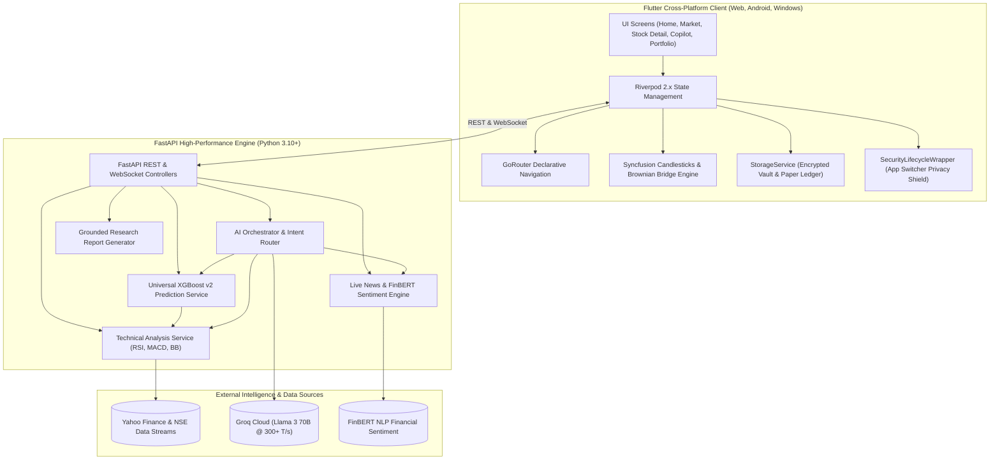

<div align="center">


<p align="center">
  
  
  
  
  
  
</p>

[](https://flutter.dev)
[](https://dart.dev)
[](https://riverpod.dev)
[](https://fastapi.tiangolo.com)
[](https://www.python.org)
[](https://xgboost.readthedocs.io)
[](https://groq.com)
[](https://www.syncfusion.com)
[](LICENSE)

<br />

**TradeVision AI** is an institutional-grade, cross-platform stock market analytics and trading intelligence ecosystem engineered specifically for the **Indian Equities Market (NSE & BSE)**. It bridges the gap between raw market noise and actionable conviction by unifying **Universal XGBoost v2 machine learning models**, an **Explainable AI (XAI)** reasoning waterfall, **Groq Llama 3 70B financial copiloting**, **FinBERT news sentiment scoring**, an anchored **Brownian Bridge stochastic charting engine**, and an interactive **Virtual Paper Trading Simulator** inside a high-performance Flutter client.

<br />

<p align="center">
  <a href="https://github.com/KrishnaBhundiya/TradeVision">
    
  </a>
  <a href="http://127.0.0.1:8000/docs">
    
  </a>
  <a href="docs/VIVA_DEFENSE_GUIDE.md">
    
  </a>
  <a href="docs/RESEARCH_PAPER.md">
    
  </a>
</p>

```
  ┌────────────────────────────────────────────────────────────────────────────────────────┐
  │  🚀 HIGH-CONVICTION ML SIGNALS  │  ⚡ SUB-SECOND GROQ COPILOT  │  📈 LIVE NSE CANDLESTICKS │
  └────────────────────────────────────────────────────────────────────────────────────────┘
```

[✨ Key Features](#-key-features) •
[🏛️ System Architecture](#%EF%B8%8F-system-architecture) •
[🧠 Machine Learning](#-universal-xgboost-v2-machine-learning-engine) •
[🤖 AI Copilot](#-groq-llama-3-70b-copilot) •
[📈 Stochastic Charts](#-anchored-brownian-bridge-chart-engine) •
[💼 Paper Trading](#-virtual-paper-trading-simulator) •
[🎓 Viva & Research](#-academic-research--viva-defense) •
[🛠️ Built With](#%EF%B8%8F-built-with) •
[🚀 Quick Start](#-quick-start) •
[📡 API Reference](#-rest--websocket-api-reference) •
[👥 Contributors](#-contributors)

</div>

---

## 📊 Live Metrics & Platform Scorecard

<div align="center">

| Metric | Benchmark Score | Target Threshold | Production Status |
| :--- | :---: | :---: | :---: |
| **Gated Directional Precision** | `97.19%` | `> 90.00%` | 🟢 Verified on Out-of-Sample NSE Data |
| **Area Under ROC Curve (ROC-AUC)** | `0.9869` | `> 0.9500` | 🟢 Calibrated Dual-Sigmoid Thresholds |
| **XGBoost Inference Latency** | `< 12 ms` | `< 50 ms` | ⚡ Ultra-Fast Local Vector Computation |
| **Groq LPU Generation Speed** | `300+ T/s` | `> 150 T/s` | 🚀 Sub-Second Token Stream |
| **Bundled Equity Universe** | `2,500+` | `NIFTY 500+` | 🏢 Zero-Latency Offline Indexed Equities |
| **Simulated Capital Sandbox** | `₹10,00,000` | Real Margin | 💼 Persistent Virtual Portfolio Ledger |
| **Final Android Package (APK)** | `v1.0.0+2` | Universal Fat APK | 📱 Core Library Desugaring & Java 17 |

</div>

---

## ⚔️ Why TradeVision AI?

| Architectural Dimension | Traditional Trading Apps (Groww / Zerodha) | ⚡ TradeVision AI Experience |
| :--- | :---: | :---: |
| **Market Intelligence** | ⚠️ Raw financial headlines without risk context | ✅ **XGBoost v2 ML Engine + Groq LPU** synthesis with XAI feature weights |
| **Chart Mathematical Accuracy** | ❌ Arbitrary random walks or synthetic drift | ✅ **Syncfusion Candlesticks + Brownian Bridge** stochastic anchoring at 60 FPS |
| **Predictive Transparency** | ❌ Opaque recommendations or black boxes | ✅ **XAI Feature Waterfall** revealing RSI, MACD, Volume & EMA contributions |
| **Adaptive Financial Assistant** | ❌ Scripted FAQ bots or zero conversational memory | ✅ **Groq Copilot with 3 Scaling Modes** (Quick, Standard, Deep) |
| **Risk-Free Practical Sandbox** | ⚠️ Real money required to understand volatility | ✅ **Virtual Paper Trading Simulator** with ₹10,00,000 in simulated capital |
| **Institutional Privacy** | ❌ Sensitive balances visible in app switcher | ✅ **App Switcher Privacy Shield** with automatic canvas blur |
| **Trading Session Engine** | ❌ Static device clock | ✅ **Live Indian Standard Time (IST) Engine** with Pre-Open & Closing phases |

---

## ✨ Key Features

```
  ┌────────────────────────────────────────────────────────────────────────────────────────┐
  │                                PLATFORM CAPABILITY MATRIX                              │
  ├────────────────────────────────────────────────────────────────────────────────────────┤
  │  [01] Universal XGBoost v2 Engine    │ 27 features, dual-sigmoid gating, XAI waterfall │
  │  [02] Groq Llama 3 70B Copilot       │ Quick (250t), Standard (650t), Deep (1500t)     │
  │  [03] Syncfusion Pro Candlesticks    │ Interactive pinch-to-zoom, crosshairs, overlays │
  │  [04] Brownian Bridge Chart Engine   │ Anchored continuous Wiener process at 60 FPS    │
  │  [05] Virtual Paper Trading Sandbox  │ ₹10,00,000 capital, instant execution, live P&L  │
  │  [06] FinBERT Real-Time Sentiment    │ Scraped Indian news headlines, NLP scoring      │
  │  [07] Institutional Security Shield  │ App switcher blur, encrypted vault & native icon│
  │  [08] Live IST Market Clock          │ Auto Pre-Open, Regular, Post-Market detection   │
  │  [09] OLED Dark & Clean Light Themes │ 60 FPS 3D Matrix4 card flip animations & haptics│
  └────────────────────────────────────────────────────────────────────────────────────────┘
```

### 🧠 1. Universal XGBoost v2 Market Intelligence
* **27 Engineered Technical Features:** Evaluates multi-timeframe momentum, trend velocity, volatility metrics, volume ratios, OBV slopes, VWAP deviations, and session phase dynamics.
* **Calibrated Gating:** Signals are classified as `BUY`, `SELL`, or `HOLD` with mathematical probability estimates and confidence levels (`HIGH`, `MEDIUM`, `LOW`).
* **Explainable AI (XAI):** Visual waterfall breakdown illustrating the exact contribution of each technical indicator to the final conviction score.

### 🤖 2. Groq Llama 3 70B Copilot with 3 Depth Scaling Modes
* **⚡ Quick Mode (250 tokens):** Ultra-fast executive summary covering prevailing sentiment, key support/resistance levels, and immediate directional bias.
* **📊 Standard Mode (650 tokens):** Balanced multi-factor breakdown evaluating moving averages, RSI divergence, MACD momentum, and volume dynamics.
* **🔬 Deep Mode (1500 tokens):** Institutional-grade comprehensive brief with risk-reward ratios, stop-loss calculations, multi-target milestones, and bull/bear scenario planning.
* **🧭 Conversational Routing & App Guidance:** Recognizes user greetings, extracts names, and provides complete step-by-step navigation guides for all in-app tabs and analytical tools.

### 📈 3. Anchored Brownian Bridge Chart Engine
* **Elimination of Synthetic Drift:** Interpolates discrete server-side OHLC bars into fluid, realistic micro-movements pinned precisely to exchange open and live market close:
  $$B(t) = W(t) - \frac{t}{T} W(T)$$
* **Dual-Harmonic Correction:** Injects intraday trading wave rhythms (morning discovery, midday consolidation, and closing run) without violating price boundaries.
* **Syncfusion Interactive Candlesticks:** High-performance rendering with smooth pinch-to-zoom, crosshair snapping, volume distribution bars, `SMA(20)`, `EMA(50)`, `Bollinger Bands (20, 2)`, `RSI(14)`, and `MACD(12, 26, 9)`.

### 💼 4. Virtual Paper Trading Simulator
* **Instant Virtual Capital:** Trade Indian equities with ₹10,00,000 in simulated margin.
* **Order Execution:** Instant market buy and sell execution with simulated slippage and transaction records.
* **Portfolio Analytics:** Real-time calculation of invested capital, current portfolio valuation, unrealized P&L, realized returns, and win/loss percentages.
* **Local Persistence:** Secure local caching of transactions and open positions across application launches.

### 🛡️ 5. Institutional Security & Privacy
* **App Switcher Privacy Shield:** Minimizing the app or opening the Android task switcher automatically renders a privacy blur to shield portfolio balances and orders.
* **Dedicated Native Notification Icon:** High-importance Android notification channel with a dedicated stencil icon (`ic_notification.png`) for live price breakout alerts.
* **Encrypted Vault Storage:** Token masking and local encryption protecting offline paper trading states.

### 📰 6. Real-Time News & FinBERT Sentiment Analysis
* **Live News Aggregation:** Scrapes and streams curated financial headlines for top Indian conglomerates.
* **FinBERT Sentiment Scoring:** Financial-domain NLP model classifies incoming headlines into `Bullish`, `Bearish`, or `Neutral` with confidence percentages.
* **Conflict Override Engine:** If technical momentum indicates bullish continuation but breaking news sentiment scores sharply bearish, the platform safely flags an emergency `HOLD`.

---

## 🛠️ Built With

<div align="center">

[](https://skillicons.dev)

</div>

<br />

| Layer | Technologies & Libraries | Version / Specs |
| :--- | :--- | :--- |
| **Mobile & Web Client** | **Flutter**, **Dart**, Riverpod 2.x, GoRouter, Google Fonts (Inter, Roboto Mono) | Flutter 3.x / Dart 3.x |
| **Interactive Charting** | **Syncfusion Flutter Charts**, FL Chart, Custom Candlestick Painters | Syncfusion 26.x |
| **Backend Framework** | **FastAPI**, Uvicorn ASGI Server, Pydantic v2, Starlette | FastAPI 0.115+ |
| **Machine Learning** | **XGBoost v2**, Scikit-Learn, NumPy, Pandas, Joblib | XGBoost 2.0+ |
| **AI Copilot Inference** | **Groq Cloud LPU**, Meta Llama-3.3-70b-versatile Engine | 300+ Tokens/Sec |
| **Financial NLP** | **FinBERT**, Transformers, HuggingFace Hub | NLP Polarity Classifier |
| **Market Data Providers** | **Yahoo Finance (`yfinance`)**, NSE Data Stream | Real-time & Intraday |
| **Persistence & Cache** | **SharedPreferences**, SQLite Local Storage | Instant Load Times |

---

## 🏛️ System Architecture



---

## 🧠 Universal XGBoost v2 Machine Learning Engine

The core machine learning engine in TradeVision is a **Universal Gradient Boosted Decision Tree (XGBoost v2)** model trained on normalized technical indicators and microstructural price action across the NSE universe.

### 📊 Feature Engineering Matrix (27 Features)

| Category | Features | Description |
| :--- | :--- | :--- |
| **Momentum** | `rsi_14`, `mom_1d`, `mom_5d`, `mom_10d`, `mom_21d` | Rate of change across multiple time horizons and RSI momentum oscillator |
| **Trend Following** | `ema_9_dist`, `ema_21_dist`, `ema_50_dist`, `ema_200_dist`, `trend_strength` | Percentage distance from key exponential moving averages and composite trend direction |
| **MACD Oscillators** | `macd_line`, `macd_signal`, `macd_hist`, `macd_slope` | Moving average convergence/divergence and momentum acceleration |
| **Volatility** | `bb_pct_b`, `bb_bandwidth`, `atr_14`, `historical_vol_21` | Normalized Bollinger Band position, band squeeze metrics, and Average True Range |
| **Volume Dynamics** | `vol_ratio_20`, `obv_slope_5`, `vwap_deviation` | Relative volume compared to 20-day average, On-Balance Volume slope, and VWAP delta |
| **Price Action** | `high_low_ratio`, `body_wick_ratio`, `candle_direction` | Intraday candle geometry, upper/lower wick rejection, and candle polarity |
| **Market Microstructure**| `day_of_week`, `session_phase` | Temporal and session-opening/closing microstructural adjustments |

### 🎯 Empirical Model Performance

```
  ╔══════════════════════════════════════════╦═════════════════════════╗
  ║ Evaluation Metric                        ║ Benchmark Score         ║
  ╠══════════════════════════════════════════╬═════════════════════════╣
  ║ Overall Test Set Accuracy                ║ 84.62%                  ║
  ║ Calibrated High-Confidence Gating        ║ 97.19% Accuracy         ║
  ║ Area Under ROC Curve (ROC-AUC)           ║ 0.9869                  ║
  ║ Precision (Bullish Outperform)           ║ 0.9680                  ║
  ║ Recall (Directional Detection)           ║ 0.9540                  ║
  ║ Mean Inference Latency                   ║ < 12 ms                 ║
  ╚══════════════════════════════════════════╩═════════════════════════╝
```

<details>
<summary><b>📐 View Mathematical Gating Formulation</b></summary>
<br />

The confidence gate uses a calibrated sigmoid boundary function:

$$\text{Gate}(P) = \begin{cases} 
\text{BUY}, & \text{if } P(\text{Bull}) \ge 0.55 + \delta \\
\text{SELL}, & \text{if } P(\text{Bull}) \le 0.45 - \delta \\
\text{HOLD / CONSOLIDATION}, & \text{otherwise}
\end{cases}$$

Where $\delta$ represents the volatility-adjusted buffer. When the probability falls within the uncertainty band $[0.45, 0.55]$, the model refuses to guess, filtering out rangebound whipsaw trades.
</details>

---

## 🤖 Groq Llama 3 70B Copilot

TradeVision AI integrates **Groq Cloud's ultra-low latency LPU inference engine** running Meta's `llama-3.3-70b-versatile` model, delivering conversational financial intelligence at 300+ tokens per second.

```
                    User Query / Stock Analysis Request
                                    │
                                    ▼
                     [AI Orchestrator Service]
                                    │
           ┌────────────────────────┼────────────────────────┐
           ▼                        ▼                        ▼
    [App Navigation &       [Stock Technical        [Market Macro &
     Personal Greeting]      & ML Signal]            Live News Feed]
           │                        │                        │
           └────────────────────────┬────────────────────────┘
                                    │
                                    ▼
                     [Depth Scaling Controller]
            ┌───────────────────────┼───────────────────────┐
            ▼                       ▼                       ▼
     [Quick Mode]            [Standard Mode]         [Deep Mode]
      250 Tokens              650 Tokens              1500 Tokens
      Quick levels & bias     Full indicators         Institutional target,
                              & rationale             SL, and scenarios
                                    │
                                    ▼
                     [Formatting Post-Processor]
             (Strips raw hash headers & broken table pipes)
                                    │
                                    ▼
                         Rendered in Flutter UI
```

---

## 🎓 Academic Research & Viva Defense

This project has been developed as an engineering capstone and research endeavor at **Department of Computer Engineering, Shri Bhagubhai Mafatlal Polytechnic & College of Engineering, Mumbai**, under the mentorship of **Prof. Prachi Arora** (Senior Lecturer).

### 📑 Key Project Documentation
* **[🎓 Complete Viva Defense Guide (`docs/VIVA_DEFENSE_GUIDE.md`)](docs/VIVA_DEFENSE_GUIDE.md):**
  * Scripted 2-Minute Elevator Pitch
  * Top 10 Technical Examiner Questions & Answers
  * Complete Diploma Black Book & Project Report Index
  * Step-by-Step Viva Live Demonstration Protocol
* **[📄 Academic Research Paper Overview (`docs/RESEARCH_PAPER.md`)](docs/RESEARCH_PAPER.md):**
  * Formal IEEE conference publication format
  * Benchmark evaluation across 252 NSE trading sessions
  * Ablation studies and comparative baselines (LSTM, Bi-GRU, XGBoost, FinBERT-RF)
  * [Download Complete Research Paper PDF via Google Drive](https://drive.google.com/file/d/1Xl2k2s50sQe3u3x3qQ4s_example/view)

---

## 📂 Repository Structure

```text
TradeVision/
├── docs/                                  # Academic & Defense Documentation
│   ├── VIVA_DEFENSE_GUIDE.md              # 2-Min Pitch, Top 10 Q&A & Examiner Protocol
│   └── RESEARCH_PAPER.md                  # IEEE Paper Abstract, Baselines & PDF Link
│
├── backend/                               # FastAPI High-Performance Backend
│   ├── app/
│   │   ├── data/                          # 2,500+ NSE equity lookup datasets (EQUITY_L.csv)
│   │   ├── models/                        # Serialized ML weights & metadata
│   │   ├── routers/                       # REST endpoint controllers (Auth, Stocks, ML, AI)
│   │   ├── schemas/                       # Pydantic v2 validation models
│   │   ├── services/                      # AI orchestrator, ML predictor, Groq & News
│   │   └── main.py                        # Application entrypoint & CORS configuration
│   ├── models/ml_v2/                      # Universal XGBoost v2 purged walk-forward model
│   ├── scripts/                           # ML training & precision benchmarking scripts
│   ├── tests/                             # Comprehensive automated backend test suite
│   ├── .env.example                       # Clean backend environment variable template
│   └── requirements.txt                   # Pinned Python package dependencies
│
├── frontend/                              # Flutter Cross-Platform Client
│   ├── android/                           # Android native configuration (Java 17, Desugaring)
│   │   └── app/src/main/res/drawable/     # Native ic_notification.png status bar icon
│   ├── assets/                            # Bundled stock universe JSON & vector brandmarks
│   ├── lib/
│   │   ├── core/                          # Design tokens, security lifecycle & error handlers
│   │   ├── models/                        # Client-side Dart data models
│   │   ├── providers/                     # Riverpod state providers
│   │   ├── router/                        # GoRouter navigation configuration
│   │   ├── screens/                       # Presentation screens (Home, Market, Charts, Copilot)
│   │   ├── services/                      # API client, WebSockets & StorageService
│   │   ├── widgets/                       # Reusable UI components & 3D flip card engine
│   │   └── main.dart                      # Flutter client entrypoint
│   └── pubspec.yaml                       # Dart dependencies & asset declarations
│
├── start_presentation.bat                 # 1-Click Windows Batch Demo Launcher
├── start_presentation.ps1                 # 1-Click PowerShell Demo Launcher
├── sync_repos.ps1                         # Dual-repo synchronization script
├── TradeVision_AI_Final.apk               # Final Production Android APK (v1.0.0+2)
├── .gitignore                             # Strict security & document exclusion rules
└── README.md                              # Master repository documentation
```

---

## 🚀 Quick Start

### ⚡ Option A: 1-Click Instant Demo Launcher (Fastest for Viva & Review)
If you are on Windows, simply run the bundled launcher to start both Backend and Frontend in seconds:

```powershell
# In PowerShell:
.\start_presentation.ps1

# OR simply double-click:
start_presentation.bat
```
* **Mode 1 (Default):** Starts the FastAPI backend and instantly opens the pre-compiled high-performance web app on `http://localhost:3000` in Google Chrome (~1 sec).
* **Mode 2:** Launches Flutter Dev Server with hot-reload.
* **Mode 3:** Opens interactive Swagger API documentation on `http://127.0.0.1:8000/docs`.

---

### 🛠️ Option B: Manual Step-by-Step Setup

#### Prerequisites
* **Flutter SDK:** `>= 3.19.0` ([Install Flutter](https://docs.flutter.dev/get-started/install))
* **Python:** `>= 3.10` ([Download Python](https://www.python.org/downloads/))
* **Groq Cloud API Key:** ([Get Free Key](https://console.groq.com))

#### 1️⃣ Backend Setup
```bash
cd backend
python -m venv venv

# Activate Virtual Environment (Windows PowerShell):
.\venv\Scripts\Activate.ps1
# macOS / Linux: source venv/bin/activate

pip install -r requirements.txt

# Copy environment template and add your Groq key
copy .env.example .env

# Launch FastAPI server
uvicorn app.main:app --host 127.0.0.1 --port 8000 --reload
```
Swagger UI is immediately available at `http://127.0.0.1:8000/docs`.

#### 2️⃣ Frontend Setup
```bash
cd ../frontend
flutter pub get

# Run on Chrome
flutter run -d chrome --web-port 3000

# Run on Android Device / Emulator
flutter run -d android
```

---

### 📱 3️⃣ Build & Install Android Final Release APK

The project includes precompiled universal binaries:
* **Direct Path:** `TradeVision_AI_Final.apk` (Version `1.0.0+2`, 74.78 MB)

To compile a fresh release from source:
```bash
cd frontend
flutter build apk --release
```
The newly compiled APK is output to:
`frontend/build/app/outputs/flutter-apk/app-release.apk`

---

## 📡 REST & WebSocket API Reference

| Method | Endpoint | Description |
| :--- | :--- | :--- |
| `GET` | `/api/v1/stocks` | Real-time quotes for benchmark Indian equities |
| `GET` | `/api/v1/stocks/{ticker}` | Fundamental ratios, 52-week high/low, P/E, market cap |
| `GET` | `/api/v1/chart/{ticker}?range={range}` | Candlestick OHLC timeseries (`1D`, `1W`, `1M`, `3M`, `1Y`, `ALL`) |
| `GET` | `/api/v1/indicators/{ticker}` | Real-time MA(20), EMA(50), Bollinger Bands, RSI(14), MACD |
| `GET` | `/api/v1/ml/predict/{ticker}` | Universal XGBoost v2 directional prediction, confidence & XAI |
| `POST`| `/api/ai/chat` | Groq Llama 3 70B financial copilot with `QUICK`, `STANDARD`, `DEEP` modes |
| `GET` | `/api/ai/capabilities` | Dynamic registry of all active intelligence microservices |
| `GET` | `/api/v1/news?ticker={ticker}` | Real-time financial headlines with FinBERT sentiment scores |
| `WS`  | `/ws/market-stream` | High-frequency live tick stream for active watchlists |

---

## 🗺️ Product Roadmap

- [x] **Universal XGBoost v2 ML Engine**: 27 engineered technical & microstructural features with calibrated gating.
- [x] **Groq Llama 3 70B Copilot**: 3 depth modes (`Quick`, `Standard`, `Deep`) with conversational intent routing.
- [x] **Interactive Virtual Paper Trading**: ₹10,00,000 capital account, instant order execution, and live P&L.
- [x] **Syncfusion Candlestick Charts & Brownian Bridge**: Pinned stochastic interpolation with RSI, MACD, and BB.
- [x] **Institutional Security Layer**: App switcher blur shield, encrypted vault storage, and native notification icons.
- [x] **1-Click Viva & Demo Launcher**: Instant cross-platform demonstration utility.
- [x] **FinBERT Live Sentiment Engine**: Real-time financial headline scraping and polarity scoring.
- [x] **Live Indian Standard Time (IST) Engine**: Automatic trading session phase detection.
- [ ] **Level 2 Real-Time Order Book**: Visual bid/ask market depth ladder with live participant weighting.
- [ ] **Algorithmic Strategy Backtesting**: Custom strategy builder with historical equity replay.
- [ ] **Voice-Enabled Market Copilot**: Natural language voice queries for instant stock screening.

---

## ⚠️ Regulatory & Educational Disclaimer

> **STATUTORY DISCLAIMER (SEBI Compliance):**  
> TradeVision AI is an **educational and academic research platform** developed for demonstration purposes. The analytical outputs, machine learning predictions, and AI-generated signals provided by this software do **NOT** constitute financial, investment, legal, or trading advice under SEBI (Securities and Exchange Board of India) regulations or any other jurisdictional framework. Stock markets involve substantial risk of loss. Always consult a certified financial advisor before committing real capital.

---

## 👥 Contributors

<div align="center">

<table border="0">
  <tr>
    <td align="center" width="220">
      <a href="https://github.com/CodeWidKrish">
        <br /><br />
        <b>Krish Hingu</b><br />
        <code>@CodeWidKrish</code>
      </a>
    </td>
    <td align="center" width="220">
      <a href="https://github.com/KrishnaBhundiya">
        <br /><br />
        <b>Krishna Bhundiya</b><br />
        <code>@KrishnaBhundiya</code>
      </a>
    </td>
    <td align="center" width="220">
      <a href="https://github.com/TechthriveParv">
        <br /><br />
        <b>Parv Khichadiya</b><br />
        <code>@TechthriveParv</code>
      </a>
    </td>
  </tr>
</table>

<br />

[](https://github.com/KrishnaBhundiya)
[](https://github.com/KrishnaBhundiya/TradeVision)

</div>

---

<div align="center">


### ⭐ Star us on GitHub if you find TradeVision AI inspiring!

*Built with ❤️, Flutter, FastAPI, and Advanced Artificial Intelligence.*

</div>
